<div align="center">

# WacOS

**macOS on top of Windows 11: menu bar, Dock, Finder, Spotlight, Control Center and Liquid Glass, in native C++.**

[](https://github.com/renzyxx/WacOS/stargazers)
[](https://github.com/renzyxx/WacOS/network/members)
[](https://github.com/renzyxx/WacOS/releases)
[](https://github.com/renzyxx/WacOS/releases/latest)
[](https://github.com/renzyxx/WacOS/actions/workflows/build.yml)


[](https://github.com/renzyxx/WacOS/releases/latest)
[](https://buymeacoffee.com/renzyx)

</div>

WacOS runs on top of Windows (same kernel, drivers and apps) and replaces what you see and touch: the menu bar,
the Dock, Finder, Spotlight, Control Center, Notification Center, Mission Control, Launchpad, window title bars and a
set of built-in apps. Pick the new macOS 27 **Golden Gate** look, the macOS Tahoe look with Liquid Glass, or the
macOS Sequoia look.

Everything is native C++ (Win32, Direct2D, DirectComposition). No Electron, no web views. It uses about 750 MB of RAM
and under 1% CPU on a 3440×1440 desktop.

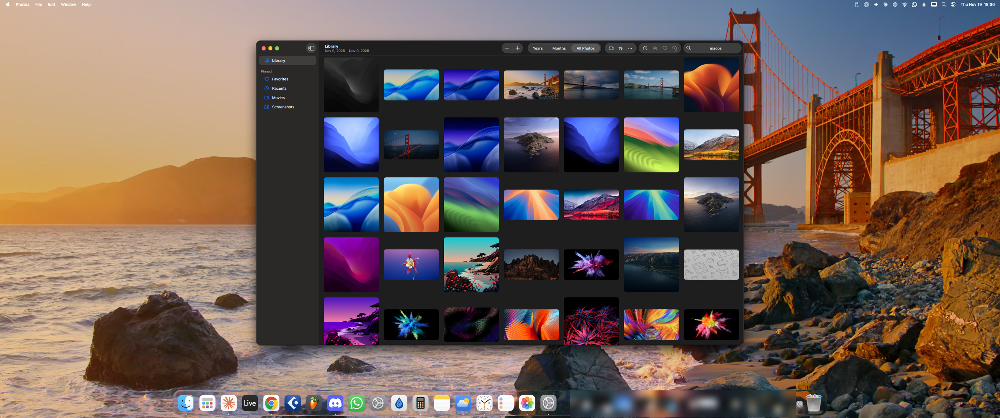

**Contents:** [Screenshots](#screenshots) · [Features](#features) · [Install](#install) · [Is it safe?](#is-it-safe) ·
[Roadmap](#roadmap) · [Support the project](#support-the-project) · [Build](#build)

## Screenshots

Three themes, in System Settings > Appearance > Theme. Switching themes never changes your own wallpaper.

### 1. macOS 27 Golden Gate (new)

The newest look, matched to Apple's macOS 27 screenshots: frosted Liquid Glass on windows, menus and the Dock,
unified toolbars, the macOS 27 icons and the Golden Gate wallpaper.


| | |
|---|---|
|  **Quick Look** plays video and music, with a frosted header and an animated open/close |  **Photos** with search |
|  **Finder** |  **System Settings** > Appearance, for every theme |
|  **Notes** | 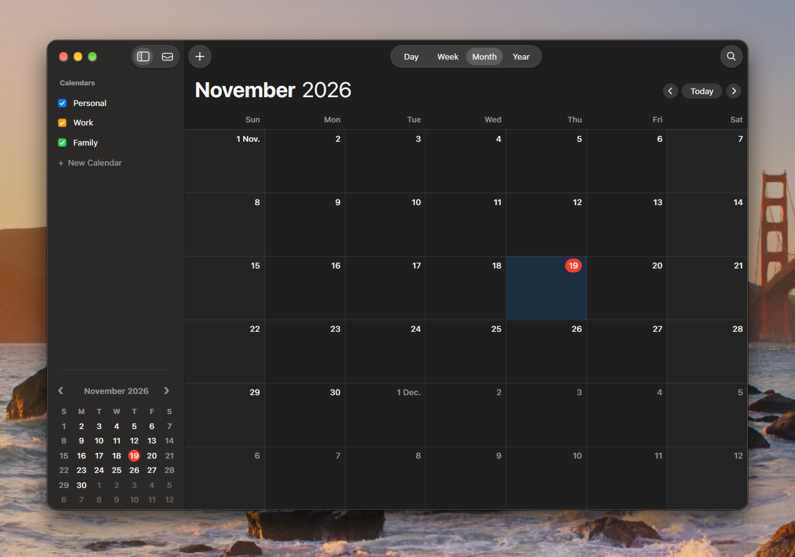 **Calendar** |
|  **Reminders** | 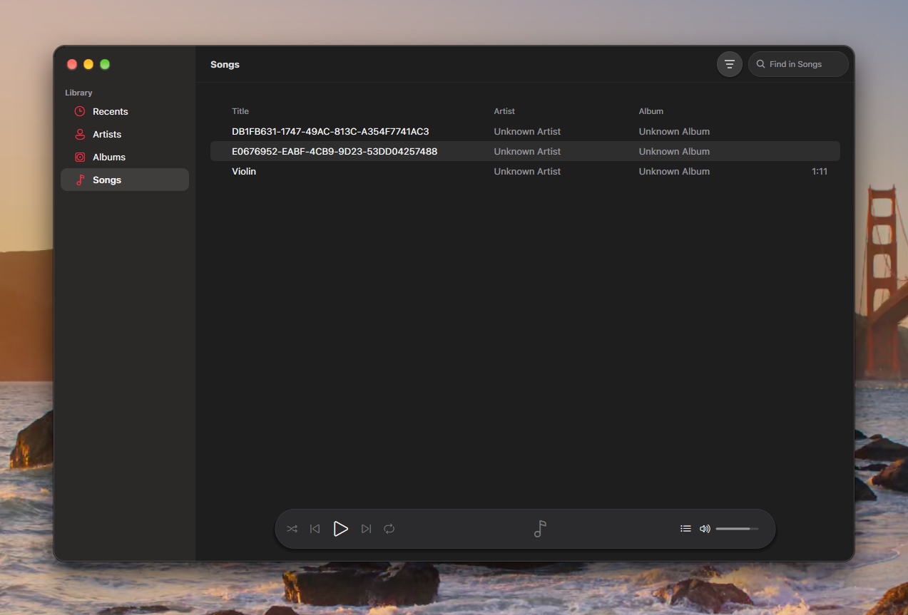 **Music** with search |
|  **Clock** with sunrise and sunset times |  **Weather** |
| 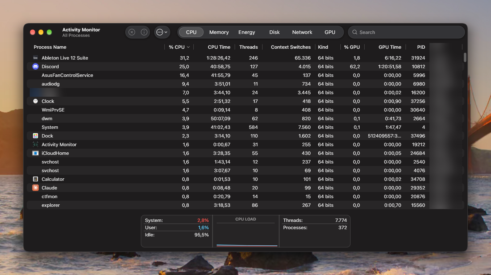 **Activity Monitor** |  **Preview** |
| 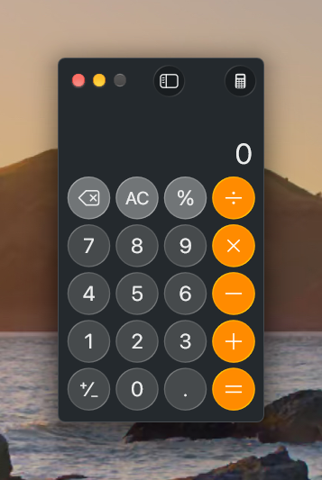 **Calculator** | 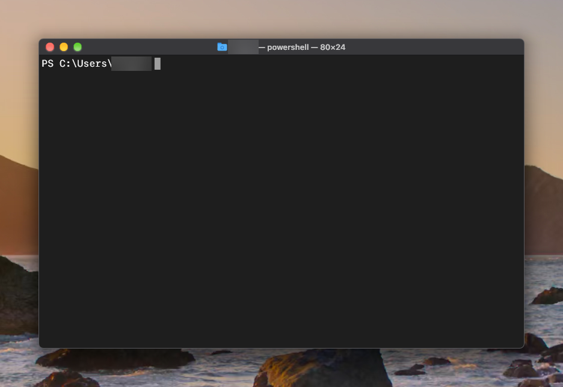 **Terminal** |
| 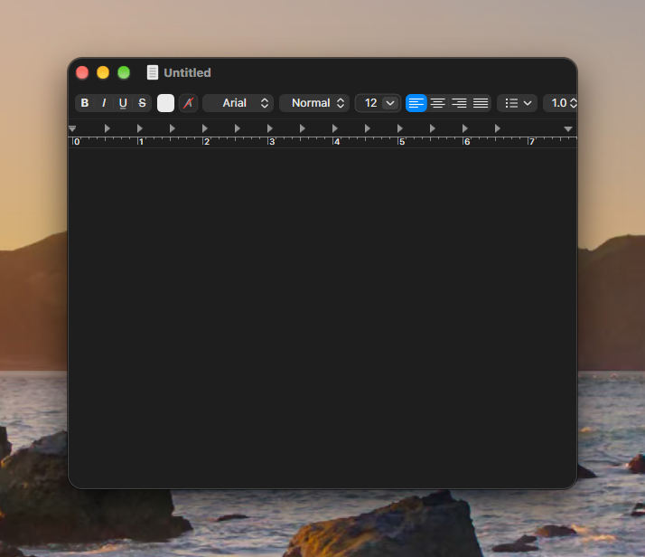 **TextEdit** | |

Also new with this theme: QuickTime Player with a frosted title bar over the video, the option to hide desktop icons,
**Edit Widgets…** on the desktop menu, clicking the empty strip beside the Dock to show the desktop, Win+D handled by
the shell, grouped notifications that open on click, and smoother glass over animated wallpapers.

### 2. macOS Tahoe (Liquid Glass)

The macOS 26 look: clear Liquid Glass with real refraction and chromatic aberration.


| | |
|---|---|
|  **Control Center** in Liquid Glass, with real refraction and chromatic aberration |  **Notification Center** with widgets |
| 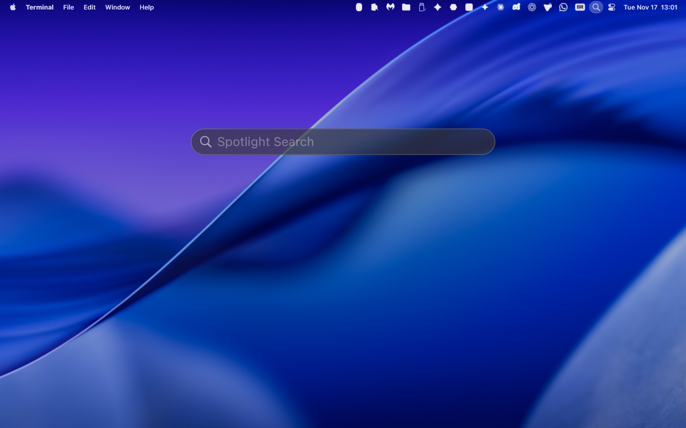 **Spotlight** |  **Applications** (Spotlight's Apps mode, with categories) |
|  **Finder** | 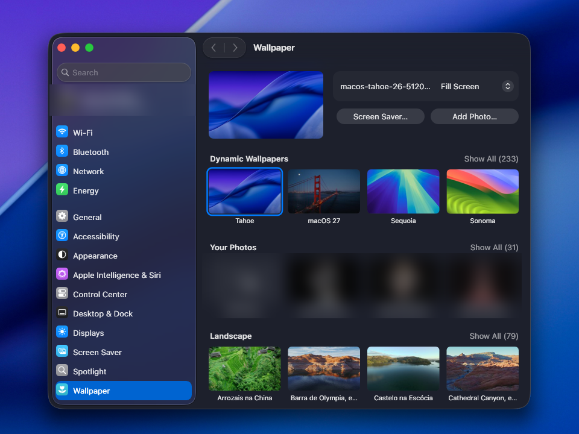 **System Settings** |
|  **Activity Monitor** |  **Force Quit Applications** (Ctrl+Alt+Esc) |
| 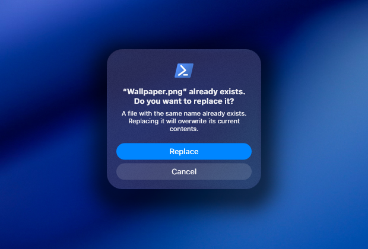 Windows message boxes become **macOS alerts** |  **Dock icon styles**: Default, Dark, Clear and Tinted |

### 3. macOS Sequoia

The same shell with the macOS 15 look (System Settings > Appearance > Theme).

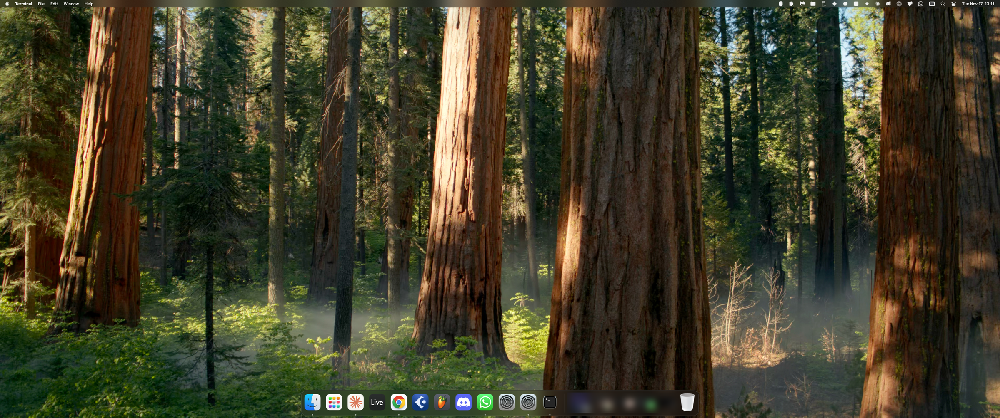

| | |
|---|---|
|  **Control Center** | 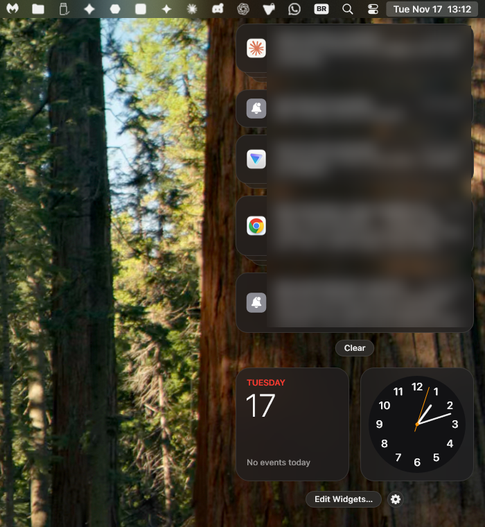 **Notification Center** |
| 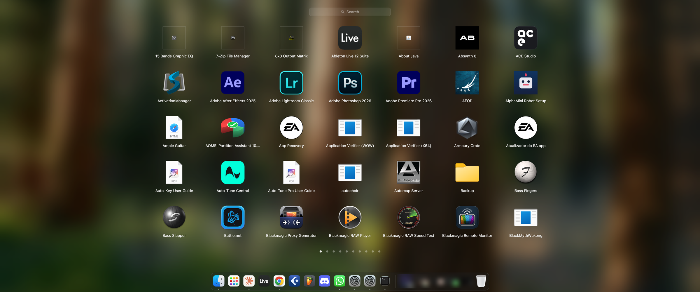 **Launchpad** |  **Spotlight** |
|  **Finder** | 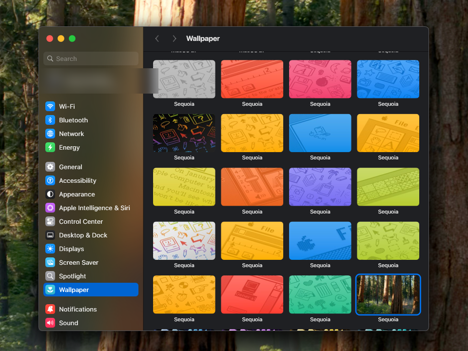 **System Settings** with the Sequoia wallpapers |

## Features

- **Menu bar** with the active app's real menus, the Apple menu, status icons and the system tray.
- **Dock** with magnification, running indicators, stacks (Downloads), minimized windows and the Trash.
- **Finder** (file manager), **Spotlight** (search with Applications, Files, Actions and Clipboard modes),
  **Control Center**, **Notification Center**, **Mission Control**, **Launchpad / Apps**, **Quick Look**,
  **Stage Manager** and **Hot Corners**.
- **Mac title bars** (traffic lights, rounded corners, shadows) on other apps' windows.
- **macOS alerts** in place of Windows message boxes, and the Mac Open/Save panel through Finder.
- **Built-in apps**: System Settings, Activity Monitor (with memory pressure), Terminal, Calculator, Notes,
  Reminders, Calendar, TextEdit, Preview, Photos, Music, QuickTime Player, Clock, Weather, Contacts,
  Time Machine, Screenshot and Force Quit.
- **Memory management like macOS**: memory pressure, App Nap and purgeable memory.
- **Themes**: macOS 27 Golden Gate, macOS Tahoe and macOS Sequoia.
- **Icon styles** (Default, Dark, Clear, Tinted), accent colors, light and dark appearance.
- **English and Portuguese** interface (English is the default; System Settings > General > Language).

## Install

1. Download the `WacOS-<date>.zip` from the [latest release](https://github.com/renzyxx/WacOS/releases/latest).
2. Extract it anywhere and run `instalar.cmd`.

Apple's fonts, sounds and cursors can't be shipped in this repository, so the installer offers to fetch them on
your own PC, from where their owners publish them:

- **SF Pro and SF Mono** from [developer.apple.com/fonts](https://developer.apple.com/fonts/) (Apple's license applies).
  The `.dmg` is opened with 7-Zip, installed through `winget` if missing.
- **macOS alert sounds** from [extratone/macOSsystemsounds](https://github.com/extratone/macOSsystemsounds), converted to WAV.
- **macOS Tahoe cursor** by [jimmyxd2 on DeviantArt](https://www.deviantart.com/jimmyxd2/art/1208233550): the installer opens
  the page, you download it, and it picks the file up from your Downloads folder.

WacOS installs for your user only (no administrator rights) in `%LOCALAPPDATA%\Programs\WacOS`.
Everything it changes is logged in `instalacao.log` there, and `desinstalar.cmd` undoes it.

- Quit WacOS: `Ctrl+Alt+Shift+F12`. Emergency exit (brings Explorer back): `Ctrl+Alt+Shift+F11`.

## Updates

New versions are published as numbered releases (`build-N`). In **System Settings > General > Software Update**,
WacOS checks GitHub on its own, shows the installed version, the latest one and the commits you don't have yet, and
**Update Now** downloads and installs it (only programs, icons and sounds are replaced; your settings stay).
GitHub Actions checks that every commit to `main` builds.

## Is it safe?

Fair question for anything that replaces your taskbar. You don't have to trust the author:

- **Open code.** Every file is in this repository, and you can build it yourself (see [Build](#build)).
- **Network.** WacOS only talks to the weather service (`api.open-meteo.com`, for the weather widget), Google search
  suggestions (only while you type in Spotlight) and GitHub (to check for updates). No telemetry, no accounts.
  Run it behind a firewall like simplewall or GlassWire and watch for yourself.
- **What it installs.** One scheduled task to start at sign-in, with normal user rights. No services, no drivers,
  no administrator rights. `desinstalar.cmd` removes everything.
- **Antivirus.** A shell has to do things that look suspicious to heuristics: start at sign-in, use keyboard and
  mouse hooks for shortcuts like the Win key and hot corners, and load its title bar DLL into other apps. The
  build-12 package shows [1/66 on VirusTotal](https://www.virustotal.com/gui/file/310ab4f16824500a8d77225fef66a62e499c32d6d5484a8752b119b7f24e67f3),
  a single AI-based heuristic. If Microsoft Defender flags it on your PC, it's a false positive that has been
  reported to Microsoft; please [open an issue](https://github.com/renzyxx/WacOS/issues) with the threat name.

## Roadmap

- **Dynamic Island**: in progress, inspired by [Atoll](https://github.com/Ebullioscopic/Atoll).
- **4th theme: Mac OS X Leopard**: Aqua, the glossy 3D Dock with reflections, the translucent menu bar and Stacks.
- Your idea? [Open an issue](https://github.com/renzyxx/WacOS/issues).

## Support the project

WacOS is free and made in my spare time. If you like it, a coffee helps a lot and keeps the updates coming ☕

<a href="https://buymeacoffee.com/renzyx"></a>

Starring the repository and sharing it also helps.

## Build

Requires Visual Studio 2022 (or Build Tools 2022) with the C++ workload.

```
build.cmd            everything
build.cmd shell      the shell only (WacOSShell.exe: menu bar, Dock, Spotlight...)
build.cmd finder     Finder only
build.cmd janelas    Mac title bars for other apps (WacOSWindow.dll, 32 and 64 bit)
tools\empacotar.ps1  the installer package (dist\WacOS-<date>.zip)
```

## Layout

- `src/shell`: the shell (menu bar, Dock, Spotlight, Control Center, Mission Control, Liquid Glass...).
- `src/finder`, `src/ajustes` (System Settings), `src/monitor` (Activity Monitor) and the other apps in `src/*`.
- `src/janelas`: Mac title bars injected into other apps' windows.
- `src/menu`: context menus on top of the real Windows shell extensions.
- `src/comum`: shared code (names, language, glass, shadows).
- `instalador`: install, update and uninstall scripts. `tools`: build and packaging tools.
- `icones`: icon packs (Sequoia, Tahoe) and SF Symbols.

## Note

Apple, macOS, Finder and related names and icons belong to Apple Inc. This is a personal, non-commercial project
and is not affiliated with Apple. The bundled icons, fonts and sounds are for personal use only.
